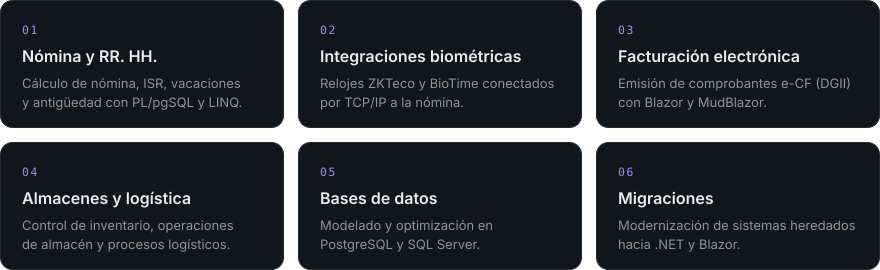
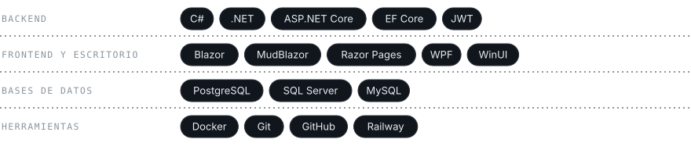

 

Desarrollo software empresarial desde hace más de cuatro años, principalmente sistemas de nómina y recursos humanos. Trabajo sobre todo con bases de datos PostgreSQL y SQL Server, integraciones con hardware y la migración de sistemas heredados a .NET.

### Lo que hago

### Stack

### Enfoque actual

Desarrollando **Nucara**, llevándola a una versión web para móviles y preparándola para que otras empresas la integren. En paralelo, aprendiendo inglés.

### Actividad

<picture>
  <source media="(prefers-color-scheme: dark)" srcset="https://raw.githubusercontent.com/AbelRyT/AbelRyT/output/contribuciones-dark.svg" />
  <source media="(prefers-color-scheme: light)" srcset="https://raw.githubusercontent.com/AbelRyT/AbelRyT/output/contribuciones.svg" />
  
</picture>

 

[LinkedIn](https://linkedin.com/in/abel-rodr%C3%ADguez-torres-9461873b0) &nbsp;·&nbsp; [Email](mailto:abelcheco10@gmail.com) &nbsp;·&nbsp; [Instagram](https://instagram.com/abelrodriguez.torres)
